# Concepts

Reference set: [CODE](CODE.md) · [DEFINITIONS](DEFINITIONS.md) ·
[EXERCISES](EXERCISES.md) · [TESTS](TESTS.md)

How the SG52 Pu-239 adjustment works, as concepts. L1 is the whole method, each
L2 diagram opens one L1 node, L3 diagrams spell out rules with steps, and L4
diagrams give the treatment of one data source, from release values to GLLS
terms. Status per node: `implemented`, `partial`, `planned`, or `external` (a
node owned by another diagram, shown for context). Dashed boxes are planned,
dotted boxes are partial.

## Notation

All vectors are columns. $D_v = \operatorname{diag}(v)$ turns a vector into a
diagonal matrix, so $D_v^{-1}$ divides element-wise by $v$.

| Symbol | Meaning | Size |
|---|---|---|
| $x$ | state vector of Pu-239 nuclear data | $n = 979$ |
| $\mu_i$, $\Sigma_i$ | prior mean and absolute prior covariance | $n$, $n \times n$ |
| $R_i$ | released relative prior covariance | $n \times n$ |
| $\mu_f$, $\Sigma_f$ | posterior mean and absolute posterior covariance | $n$, $n \times n$ |
| $E$, $C$ | measured and calculated response values | $m$ |
| $\sigma_E$, $\sigma_C$ | experimental and calculation uncertainties | $m$ |
| $\Delta$ | discrepancy $E - C$ | $m$ |
| $s$, $S$ | relative and absolute sensitivities | $m \times n$ |
| $\Sigma_E$ | observation covariance | $m \times m$ |
| $V$ | response covariance | $m \times m$ |

The method in three lines: convert the relative release data to absolute form,
update in absolute form, convert the result back to relative form against the
prior.

$$
\Sigma_i = D_{\mu_i} R_i D_{\mu_i},
\qquad S = D_C\, s\, D_{\mu_i}^{-1}
\qquad \text{(relative} \to \text{absolute)}
$$

$$
\mu_f = \mu_i + \Sigma_i S^\top V^{-1} \Delta,
\qquad \Sigma_f = \Sigma_i - \Sigma_i S^\top V^{-1} S \Sigma_i,
\qquad V = S \Sigma_i S^\top + \Sigma_E
\qquad \text{(absolute GLLS)}
$$

$$
r = D_{\mu_i}^{-1} (\mu_f - \mu_i),
\qquad R_f = D_{\mu_i}^{-1} \Sigma_f D_{\mu_i}^{-1}
\qquad \text{(absolute} \to \text{relative, normalized on prior)}
$$

## L1 · SG52 adjustment

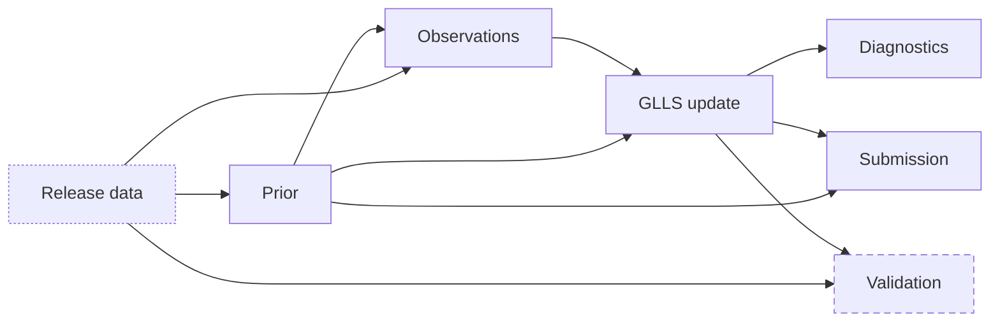

| Node | Meaning | Terms | Status |
|---|---|---|---|
| `ReleaseData` | The coordinators' input package: prior covariances, integral and differential data with sensitivities, validation benchmarks and the output template. Prior, integral data and every released differential set are used; the validation data are not (the SNEAK validation step is ignored by decision of the 2026-10-26 meeting) | release, release data | partial |
| `Prior` | ENDF/B-VIII.0 Pu-239 means and absolute covariance on the state vector | prior, state vector | implemented |
| `Observations` | Discrepancies, absolute sensitivities and observation covariance for the responses an exercise uses: integral responses, Marini nu-bar, Marini and Keegan PFNS, Snyder and Dongwi | observation, integral response, differential measurement | implemented |
| `Glls` | Linear Bayesian update of the prior with the observations, in absolute form | GLLS, posterior | implemented |
| `Diagnostics` | Checks and summaries of the update: reproduction, linearized responses, uncertainty reduction, covariance health, PFNS normalization and positivity, and the comparison with ENDF/B-VIII.1 | linearized prediction, PFNS normalization, target adjustment | implemented |
| `Submission` | Relative and absolute results filled into the release 4 output template, normalized on the prior mean. The release 3 template until 2026-11-23; before 2026-10-22 the release 2 template, with the posterior relative covariance normalized on the posterior mean | output template, submission | implemented |
| `Validation` | Predict the validation benchmarks with the adjusted data and compare with measurement | validation benchmark | planned |

### L2 · Release data (`ReleaseData`)

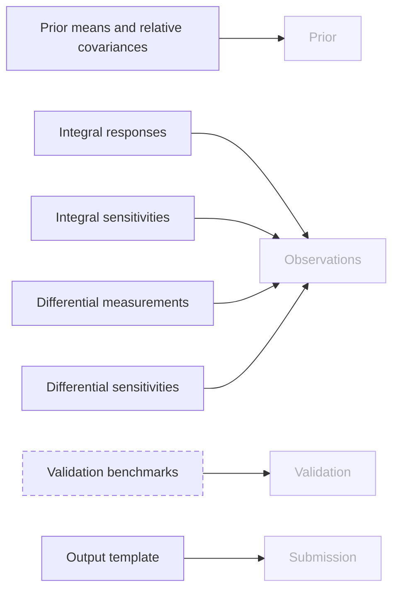

| Node | Meaning | Terms | Status |
|---|---|---|---|
| `PriorCovariances` | Released ENDF/B-VIII.0 Pu-239 group means and relative covariance blocks, one file per QID pair | relative covariance, QID | implemented |
| `IntegralSet` | JEZEBEL and EUCLID responses: measured and calculated values with their uncertainties, in released row order | integral response, experimental uncertainty, calculation uncertainty | implemented |
| `IntegralSensitivities` | Relative sensitivities of each integral response to every released nuclide parameter | relative sensitivity | implemented |
| `DifferentialSet` | Marini nu-bar, Marini and Keegan PFNS, Snyder and Dongwi fission cross sections, with their covariances; all are read. SACS-Cf is listed in the specification but not released | differential measurement, EXFOR | implemented |
| `DifferentialSensitivities` | Sensitivities of each differential measurement to the state vector: one-hot rows released for nu-bar and the fission sets, and for PFNS since release 4 (none in release 3); all are used | relative sensitivity, differential sensitivity | implemented |
| `ValidationSet` | SNEAK-7A/B models and measured responses | validation benchmark, SNEAK | planned |
| `OutputTemplate` | The NEA results workbook, release 4 version: questions (eleven, six of them on differential data), groups, prior sheets and full 928-state covariance sheets. The release 3 version until 2026-11-23 had the first five questions only | output template, questions sheet, prior sheets | implemented |
| `Prior` | See L1 | | external |
| `Observations` | See L1 | | external |
| `Validation` | See L1 | | external |
| `Submission` | See L1 | | external |

### L2 · Prior (`Prior`)

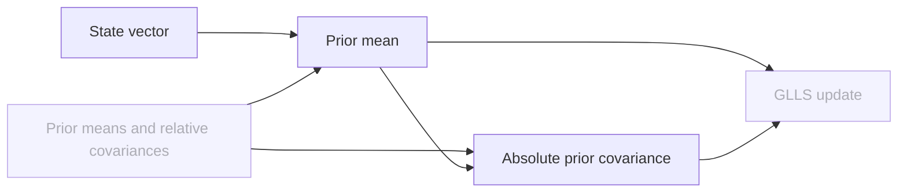

The state vector stacks nine ordinary quantities on 51 energy groups, ten PFNS
slices (one per incident-energy group) on 51 outgoing groups, and ten mubar
values:

$$
n = \underbrace{9 \times 51}_{459} + \underbrace{10 \times 51}_{510} + \underbrace{10}_{\text{mubar}} = 979
$$

The release gives each QID pair $(q, q')$ as one relative block, $51 \times 51$
(a mubar state is $1 \times 1$). It lands at the two QIDs' state ranges; a pair
the release does not give is a zero block:

$$
(R_i)_{(q,g),(q',g')} = R^{(q,q')}_{g g'},
\qquad
R^{(q,q')} = 0 \text{ if not released}
$$

Relative to absolute, entry by entry and as a matrix:

$$
(\Sigma_i)_{jk} = \mu_{i,j}\, (R_i)_{jk}\, \mu_{i,k}
\qquad\Longleftrightarrow\qquad
\Sigma_i = D_{\mu_i} R_i D_{\mu_i}
$$

A state with $\mu_{i,j} = 0$, or with $(R_i)_{jj} = 0$, has zero prior
variance, and its row and column of $\Sigma_i$ are zero ($\Sigma_i$ is
positive semidefinite). The GLLS update cannot move it:
$(\mu_f - \mu_i)_j = (\Sigma_i S^\top V^{-1} \Delta)_j = 0$ and
$(\Sigma_f)_{jj} = 0$.

| Node | Meaning | Terms | Status |
|---|---|---|---|
| `StateVector` | Canonical ordering of the 979 states by QID and energy group; every other array is aligned to it | state vector, QID, energy group | implemented |
| `PriorMean` | Released group means flattened in state-vector order | prior, ENDF/B-VIII.0 | implemented |
| `AbsolutePriorCovariance` | Released relative blocks scaled by both prior means and assembled into one symmetric matrix | absolute covariance, relative covariance | implemented |
| `PriorCovariances` | See Release data | | external |
| `Glls` | See L1 | | external |

### L2 · Observations (`Observations`)

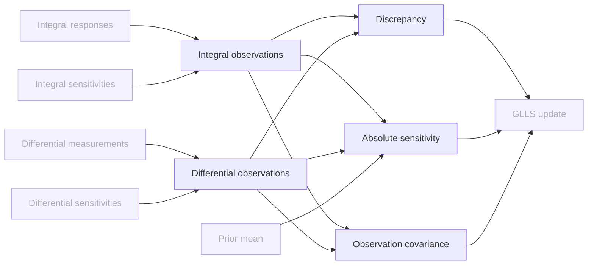

Every source, integral or differential, ends in the same three terms:
discrepancy, absolute sensitivity and observation covariance. The released
sensitivity is relative to the calculated value, so the conversion multiplies
by $C$ and divides by the prior mean:

$$
\Delta_k = E_k - C_k,
\qquad
s_{kj} = \frac{\partial C_k / C_k}{\partial x_j / x_j},
\qquad
S_{kj} = \frac{\partial C_k}{\partial x_j} = \frac{C_k\, s_{kj}}{\mu_{i,j}}
\quad\Longleftrightarrow\quad
S = D_C\, s\, D_{\mu_i}^{-1}
$$

Read as a model, a row of $S$ says how the calculated value follows the state
vector to first order: $C_k(x) \approx C_k + \sum_j S_{kj}(x_j - \mu_{i,j})$.
The per-source sections below give $E$, $C$, $s$ and $\Sigma_E$ for each data
source.

Relative form, if ever used, must normalize every term on the same vector
$N$, either $E$ or $C$ (method rule):

$$
\tilde\Delta = D_N^{-1} \Delta,
\qquad
\tilde\Sigma_E = D_N^{-1} \Sigma_E D_N^{-1},
\qquad
\tilde S = D_N^{-1} S D_{\mu_i} = D_N^{-1} D_C\, s
$$

With $N = C$ the released $s$ is used as is; with $N = E$ it must be scaled by
$C/E$. Using $s$ unscaled next to $E$-normalized discrepancies is the mixing
the rule forbids. The workflow stays absolute, so the rule holds by
construction.

| Node | Meaning | Terms | Status |
|---|---|---|---|
| `IntegralObservations` | JEZEBEL and EUCLID responses selected, their Pu-239 sensitivity columns mapped to states, and their discrepancies, sensitivities and covariance formed. Split out of this diagram on 2026-11-25; its steps were L2 nodes before | integral response, response ID, relative sensitivity | implemented |
| `Discrepancy` | Measured minus calculated value per response | discrepancy | implemented |
| `AbsoluteSensitivity` | Convert relative sensitivities to absolute derivatives with the calculated value and the prior mean | absolute sensitivity | implemented |
| `ObservationCovariance` | Covariance of the discrepancies, block-diagonal over data sets: the integral block from the experimental and calculation uncertainties (method rule), each differential block from its released correlations. Used the published total uncertainty before 2026-10-22; integral responses only before 2026-10-23 | observation covariance, assumption | implemented |
| `DifferentialObservations` | Differential points selected and aligned to the state vector; their discrepancies, sensitivities and covariances join the integral ones through the same rules. Built for nu-bar, PFNS, Snyder and Dongwi | differential measurement, differential point | implemented |
| `IntegralSet` | See Release data | | external |
| `IntegralSensitivities` | See Release data | | external |
| `DifferentialSet` | See Release data | | external |
| `DifferentialSensitivities` | See Release data | | external |
| `PriorMean` | See Prior | | external |
| `Glls` | See L1 | | external |

#### L3 · Integral observations (`IntegralObservations`)

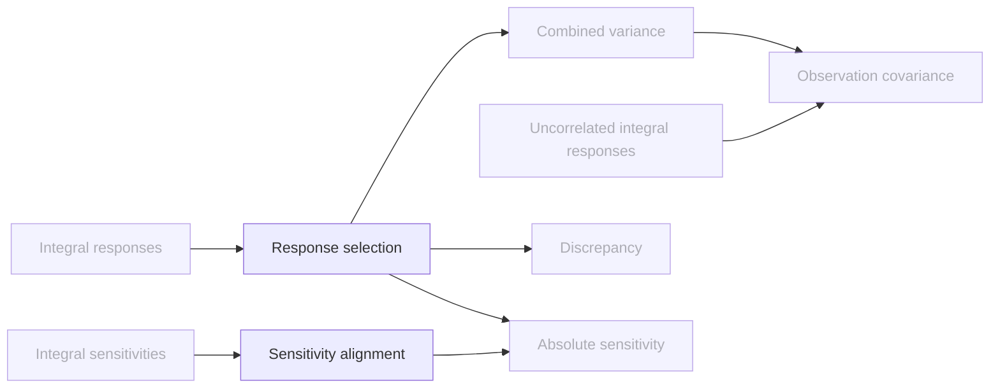

An integral response $k$ is released with $E_k$, $\sigma_{E,k}$, $C_k$,
$\sigma_{C,k}$, all absolute, and a relative sensitivity $s_{kp}$ to every
released nuclide parameter $p$. An exercise selects responses by response ID,
in released order. A map $\pi$ sends each Pu-239 parameter to its state;
parameters of other nuclides have no state and are dropped, and a state no
parameter reaches gets a zero column:

$$
\Delta_k = E_k - C_k,
\qquad
S_{kj} = \frac{C_k}{\mu_{i,j}} \sum_{p:\, \pi(p) = j} s_{kp},
\qquad
\Sigma_E^{\text{int}} = \operatorname{diag}\!\left(\sigma_{E,k}^2 + \sigma_{C,k}^2\right)
$$

$\pi$ is one-to-one (a duplicate or unknown Pu-239 parameter is an error), so
the sum has at most one term. Pu-239 total nu-bar parameters land on MT452,
prompt spectrum parameters on (PFNS slice, outgoing group), mubar parameters on
their incident range. The released sensitivity uncertainties are not
propagated (assumption).

| Node | Meaning | Terms | Status |
|---|---|---|---|
| `ResponseSelection` | Pick the responses an exercise uses, by response ID, keeping released order | integral response, response ID | implemented |
| `SensitivityAlignment` | Map each released Pu-239 sensitivity column to its state; reject duplicates and unknown parameters; drop other nuclides | relative sensitivity, state vector | implemented |
| `IntegralSet` | See Release data | | external |
| `IntegralSensitivities` | See Release data | | external |
| `CombinedVariance` | See Observation covariance | | external |
| `UncorrelatedResponses` | See Observation covariance | | external |
| `Discrepancy` | See Observations | | external |
| `AbsoluteSensitivity` | See Observations | | external |
| `ObservationCovariance` | See Observations | | external |

#### L3 · Observation covariance (`ObservationCovariance`)

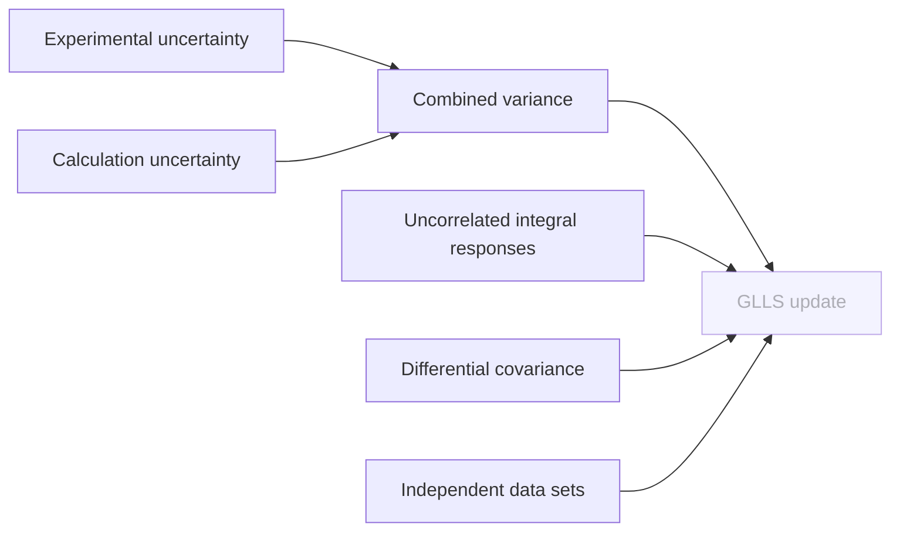

Integral block, with the release's bias using the same denominator,
$(C - E) / \sqrt{\sigma_E^2 + \sigma_C^2}$:

$$
\Sigma_E^{\text{int}} = \operatorname{diag}\!\left(\sigma_{E,k}^2 + \sigma_{C,k}^2\right)
\qquad \text{(method rule)}
$$

Differential block $d$, from the released relative uncertainties $u$ and
correlation matrix $\rho$, with no calculation uncertainty (assumption), and
the whole matrix block-diagonal over data sets (assumption):

$$
\sigma_{E,k} = u_k E_k,
\qquad
\Sigma_E^{(d)} = D_{\sigma_E}\, \rho^{(d)}\, D_{\sigma_E},
\qquad
\Sigma_E = \operatorname{blockdiag}\!\left(\Sigma_E^{\text{int}}, \Sigma_E^{(1)}, \Sigma_E^{(2)}, \dots\right)
$$

| Node | Meaning | Terms | Status |
|---|---|---|---|
| `ExperimentalUncertainty` | Released absolute uncertainty of each measured value; read and stored | experimental uncertainty | implemented |
| `CalculationUncertainty` | Released absolute uncertainty of each calculated value; read and stored | calculation uncertainty | implemented |
| `CombinedVariance` | Sum of the squared experimental and calculation uncertainties per response; replaced the release 2 published total on 2026-10-22 | observation covariance, method rule | implemented |
| `UncorrelatedResponses` | Off-diagonal entries between integral responses are zero, because the release gives no covariance between them | assumption | implemented |
| `DifferentialCovariance` | Absolute experimental covariance of one differential data set from its relative uncertainties and full correlation matrix; no calculation uncertainty | differential covariance, assumption | implemented |
| `IndependentDataSets` | Zero covariance between data sets: the integral block and each differential set | independent data sets, assumption | implemented |
| `Glls` | See L1 | | external |

#### L3 · Differential observations (`DifferentialObservations`)

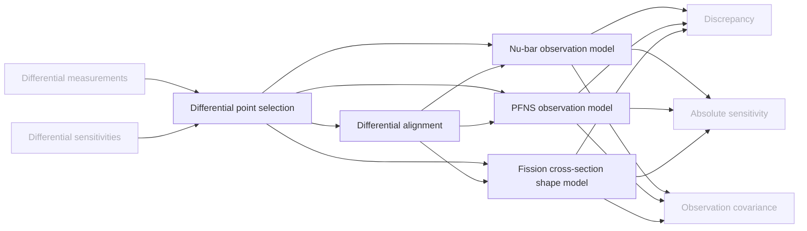

Shared by every differential source. A point $k$ is kept when its energies lie
on the group grids (at most 20 MeV), its released sensitivity row is non-zero
and its calculated value is not `null`. Every released row is one-hot: a single
entry 1 on the state $j(k)$ whose energy group holds the point (a nu-bar or
cross-section row has 52 columns, column 51 always zero; a PFNS row is
$10 \times 51$, slice by outgoing group). Alignment places the entry on
$j(k)$ and checks $j(k)$ against an independent lookup of the point's
energies. With $s_{kj} = \delta_{j,\,j(k)}$ the general rules reduce to

$$
\Delta_k = E_k - C_k,
\qquad
S_{kj} = \frac{C_k}{\mu_{i,j(k)}}\, \delta_{j,\,j(k)},
\qquad
C_k(x) \approx C_k\, \frac{x_{j(k)}}{\mu_{i,j(k)}}
$$

so a point's calculated value scales with the relative change of its one
state, and several points in one group share that state. Each data set has its
own covariance block from its relative uncertainties $u$ and correlations
$\rho$, with no calculation uncertainty (assumption):

$$
\sigma_{E,k} = u_k E_k,
\qquad
\Sigma_E^{(d)} = D_{\sigma_E}\, \rho^{(d)}\, D_{\sigma_E}
$$

The three source models below say what $C$ is, which state $j(k)$ is and what
is added to $\Sigma_E^{(d)}$.

| Node | Meaning | Terms | Status |
|---|---|---|---|
| `DifferentialSelection` | Keep the points of a data set that lie on the group grids, have a non-zero sensitivity row and a calculated value, in released order; give each a response ID | differential point, response ID, energy group | implemented |
| `DifferentialAlignment` | Place each released one-hot sensitivity row on its state: QID and energy group for nu-bar (52 columns, column 51 zero), PFNS slice and outgoing group for PFNS ($10 \times 51$), checked against a lookup of the point's energies | differential sensitivity, one-hot sensitivity, state vector | implemented |
| `NubarObservationModel` | Marini nu-bar points: prompt values used as released, rows on MT452. Added on 2026-11-25 as the parent of the nu-bar treatment; `NubarAsTotal` was a node of this diagram before | Marini nu-bar, as-MT452 rule | implemented |
| `PfnsObservationModel` | Marini and Keegan PFNS points: released block-normalized calculated values, one-hot rows on (PFNS slice, outgoing group), no floating normalization factor. Before 2026-11-23 an open design question, because release 3 gave the PFNS files neither calculated values nor sensitivities | PFNS observation model, PFNS block, block-normalized calculated value | implemented |
| `CrossSectionShapeModel` | Snyder and Dongwi shape points: released calculated values, one-hot MT18 rows, and a marginalized normalization factor with prior uncertainty $s_N$. Before 2026-11-23 an open design question | shape data set, shape normalization uncertainty, differential sensitivity | implemented |
| `DifferentialSet` | See Release data | | external |
| `DifferentialSensitivities` | See Release data | | external |
| `Discrepancy` | See Observations | | external |
| `AbsoluteSensitivity` | See Observations | | external |
| `ObservationCovariance` | See Observations | | external |

##### L4 · Nu-bar observations (`NubarObservationModel`)

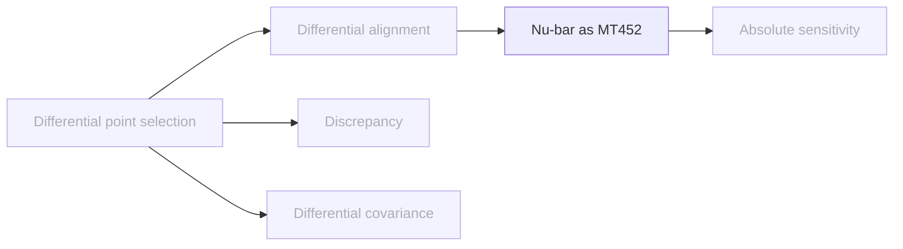

Point $k$ is a prompt nu-bar at incident energy $E_{\text{in},k}$ in group
$g(k)$. $E_k$ is measured prompt nu-bar; $C_k$ is the released ENDF/B-VIII.0
prompt nu-bar (MT456) at that energy. The row lands on total nu-bar, so the
prompt calculated value follows the relative change of MT452 in its group, and
MT456 gets no sensitivity:

$$
\Delta_k = E_k - C_k,
\qquad
S_{k,(452,g(k))} = \frac{C_k}{\mu_{i,(452,g(k))}},
\qquad
S_{k,(456,\cdot)} = 0,
\qquad
\Sigma_E^{(\nu)} = D_{uE}\, \rho\, D_{uE}
$$

| Node | Meaning | Terms | Status |
|---|---|---|---|
| `NubarAsTotal` | Nu-bar data adjust MT452 (total nu-bar), though Marini measured prompt nu-bar; MT456 receives no sensitivity | as-MT452 rule, MT452, MT456 | implemented |
| `DifferentialSelection` | See Differential observations | | external |
| `DifferentialAlignment` | See Differential observations | | external |
| `Discrepancy` | See Observations | | external |
| `AbsoluteSensitivity` | See Observations | | external |
| `DifferentialCovariance` | See Observation covariance | | external |

##### L4 · PFNS observations (`PfnsObservationModel`)

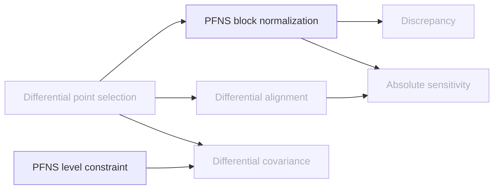

A PFNS block $b$ is the set of points at one incident energy
$E_{\text{in},b}$, measured at outgoing energies $E_{\text{out},k}$ over a
limited range. Its slice $p(b)$ is the PFNS slice holding $E_{\text{in},b}$;
several blocks can share a slice. The states of a slice are group values that
sum to one over the 51 outgoing groups.

The released calculated value is block-normalized: the ENDF/B-VIII.0 spectrum
$\chi_i$, a density normalized to one over all outgoing energies, scaled to
the measured integral $I_b$ of the block (trapezoid weights $w_k$ over the
measured range):

$$
C_k = \chi_i\!\left(E_{\text{out},k} \mid E_{\text{in},b}\right) I_b,
\qquad
\int_0^\infty \chi_i \, dE_\text{out} = 1,
\qquad
I_b = \sum_{k \in b} w_k E_k
$$

Over the measured range $C$ does not reach $I_b$: the tails outside it are
missing, so the in-range fraction $f_b$ is below one (0.952–0.956 for Marini,
0.985–0.998 for Keegan). At the prior, the weighted residual of every block is
therefore positive:

$$
f_b = \frac{1}{I_b} \sum_{k \in b} w_k C_k \le 1,
\qquad
\sum_{k \in b} w_k \Delta_k = (1 - f_b)\, I_b \ge 0
$$

The row of point $k$ is one-hot on (slice $p(b)$, outgoing group $g(k)$),
and $I_b$ is held fixed: it does not follow $x$, and its dependence on $E$ is
not propagated ($\sigma_C = 0$, assumption). The covariance is the plain
differential block:

$$
S_{k,(p(b),g(k))} = \frac{C_k}{\mu_{i,(p(b),g(k))}},
\qquad
\Sigma_E^{(\text{PFNS})} = D_{uE}\, \rho\, D_{uE}
$$

Level constraint. Scaling slice $p$ by $1 + \varepsilon$ scales the predicted
block integral to $(1 + \varepsilon) f_b I_b$, while the data integral stays
$I_b$. Nothing in $S$ or $\Sigma_E^{(\text{PFNS})}$ absorbs a level difference
between a block and its slice, so the data constrain the level of each slice
they touch as well as its shape. Block normalization removes the data's
overall scale from the prior residual: $E \to (1 + a) E$ gives
$I_b \to (1 + a) I_b$ and $\Delta \to (1 + a)\Delta$. It does not remove the
scale from the likelihood, which still weighs a change of level with
$\Sigma_E^{(\text{PFNS})}$.

The alternative, **not built**, is a floating normalization factor per block,
$C_b \to N_b C_b$ with $N_b = 1 \pm \sigma_N$. Marginalized, it adds
$\sigma_N^2 C_b C_b^\top$ to the block's covariance; carried as an extra state,
it has prior variance $\sigma_N^2$ and sensitivity column $C_b$. Both give the
same update of $x$. As $\sigma_N \to \infty$ the gain on a residual
proportional to $C_b$ goes to zero, $\Sigma_i S^\top V^{-1} C_b \to 0$, so the
block keeps only its shape information.

| Node | Meaning | Terms | Status |
|---|---|---|---|
| `PfnsBlockNormalization` | The released calculated value is the prior spectrum times the block's measured integral $I_b$; its in-range fraction $f_b < 1$ leaves a positive weighted residual $(1 - f_b) I_b$ in every block at the prior | block-normalized calculated value, PFNS block, in-range fraction | implemented |
| `PfnsLevelConstraint` | No floating normalization factor: $I_b$ is held fixed and the PFNS covariance has no level term, so the PFNS data constrain the level of the slices they touch, not only their shape (assumption). **Open:** the 2026-11-24 feedback asks for one floating factor per block with $\sigma_N$ = 100 % | PFNS observation model, floating normalization factor | implemented |
| `DifferentialSelection` | See Differential observations | | external |
| `DifferentialAlignment` | See Differential observations | | external |
| `Discrepancy` | See Observations | | external |
| `AbsoluteSensitivity` | See Observations | | external |
| `DifferentialCovariance` | See Observation covariance | | external |

##### L4 · Fission cross-section shape observations (`CrossSectionShapeModel`)

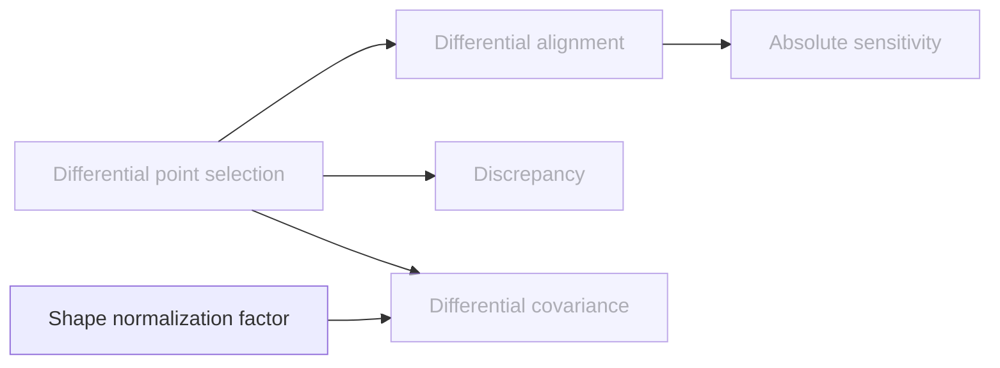

Point $k$ is a fission cross-section value at incident energy in group
$g(k)$. $E_k$ and $C_k$ (ENDF/B-VIII.0 MT18) are used as released; the row is
one-hot on MT18:

$$
\Delta_k = E_k - C_k,
\qquad
S_{k,(18,g(k))} = \frac{C_k}{\mu_{i,(18,g(k))}}
$$

The shape file's covariance has its overall normalization component removed.
The missing normalization becomes a factor $N$ on the whole data set, with
prior $N = 1 \pm s_N$, $s_N$ the removed normalization (systematic) error
(1.17 % Snyder, 1.34 % Dongwi). To first order around $N = 1$,
$x = \mu_i$:

$$
N\, C_k(x) \approx C_k + \sum_j S_{kj}(x_j - \mu_{i,j}) + C_k (N - 1)
$$

The last term is treated as observation noise with variance $s_N^2$, so it adds
a rank-one term to the block and the state vector is unchanged. The term is
built on $E$, like $\sigma_E = uE$ (assumption):

$$
\Sigma_E^{(\text{shape})} = D_{uE}\, \rho\, D_{uE} + s_N^2\, E E^\top
$$

With $s_N$ of about 1 %, the data set still carries the absolute level of MT18
with an uncertainty of about $s_N$. **Open:** the 2026-11-24 feedback says a
shape data set carries no absolute information and asks for $\sigma_N$ = 100 %
instead of $s_N$; the limit is the one in PFNS observations.

| Node | Meaning | Terms | Status |
|---|---|---|---|
| `ShapeNormalizationFactor` | One normalization factor per shape data set, prior $1 \pm s_N$, marginalized into the data set's covariance block as $s_N^2 E E^\top$ (assumption) | shape normalization uncertainty, floating normalization factor | implemented |
| `DifferentialSelection` | See Differential observations | | external |
| `DifferentialAlignment` | See Differential observations | | external |
| `Discrepancy` | See Observations | | external |
| `AbsoluteSensitivity` | See Observations | | external |
| `DifferentialCovariance` | See Observation covariance | | external |

### L2 · GLLS update (`Glls`)

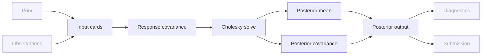

Absolute GLLS. $V$ is symmetric positive definite, so it is factorized once
and both right-hand sides are solved without forming $V^{-1}$:

$$
V = S \Sigma_i S^\top + \Sigma_E = L L^\top,
\qquad V a = \Delta,
\qquad V B = S \Sigma_i
$$

$$
\mu_f = \mu_i + \Sigma_i S^\top a,
\qquad
\Sigma_f = \Sigma_i - \Sigma_i S^\top B
$$

| Node | Meaning | Terms | Status |
|---|---|---|---|
| `InputCards` | Read prior, observations and output targets named by input cards; check shapes | input card | implemented |
| `ResponseCovariance` | Prior response covariance plus observation covariance | response covariance | implemented |
| `CholeskySolve` | Factorize the response covariance and solve for the gain terms; fail if it is not positive definite | response covariance | implemented |
| `PosteriorMean` | Prior mean plus the gain applied to the discrepancy | posterior | implemented |
| `PosteriorCovariance` | Prior covariance minus the information gained | posterior, absolute covariance | implemented |
| `PosteriorOutput` | Write posterior mean and covariance as float64 datasets | posterior | implemented |
| `Prior` | See L1 | | external |
| `Observations` | See L1 | | external |
| `Diagnostics` | See L1 | | external |
| `Submission` | See L1 | | external |

### L2 · Diagnostics (`Diagnostics`)

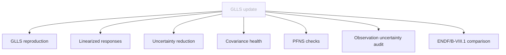

Linearized responses and the residual identity that ties them to the update:

$$
C_f = C + S (\mu_f - \mu_i),
\qquad
E - C_f = \Sigma_E V^{-1} \Delta
$$

Response uncertainty before and after, from the same sensitivities:

$$
\sigma_{C,i} = \sqrt{\operatorname{diag}(S \Sigma_i S^\top)},
\qquad
\sigma_{C,f} = \sqrt{\operatorname{diag}(S \Sigma_f S^\top)}
$$

PFNS normalization per incident-energy slice $p$, flagged above $10^{-6}$, and
positivity per state:

$$
\varepsilon_p = \left\lvert \sum_{g=1}^{51} \mu_{f,(p,g)} - 1 \right\rvert,
\qquad
\mu_{f,j} \ge 0
$$

| Node | Meaning | Terms | Status |
|---|---|---|---|
| `GllsReproduction` | Recompute the update independently and compare with the program's posterior | GLLS | implemented |
| `LinearizedResponses` | Posterior responses predicted to first order, C/E before and after, and the residual identity; per data set, $\chi^2/m$ before and after and the count within one observation standard deviation | linearized prediction, residual identity, C/E, $\chi^2/m$ | implemented |
| `UncertaintyReduction` | Prior and posterior standard deviations per state, family and QID, and each response's variance split by QID | uncertainty reduction | implemented |
| `CovarianceHealth` | Symmetry error and eigenvalue range of the prior and posterior covariances | absolute covariance | implemented |
| `PfnsChecks` | Normalization of each posterior PFNS slice and sign of every posterior state; flags only, no correction | PFNS normalization, positivity | implemented |
| `UncertaintyAudit` | Check that each observation standard deviation equals the quadrature of its experimental and calculation uncertainties; fails otherwise. Before 2026-10-22 it compared the release 2 published total uncertainty with that quadrature | experimental uncertainty, calculation uncertainty | implemented |
| `EndfComparison` | Compare the posterior with ENDF/B-VIII.1 on the same state vector: reference group values of both libraries, a reproduction gate against the released prior, and per-QID target adjustment and consistency | ENDF/B-VIII.1, target adjustment | implemented |
| `Glls` | See L1 | | external |

#### L3 · ENDF/B-VIII.1 comparison (`EndfComparison`)

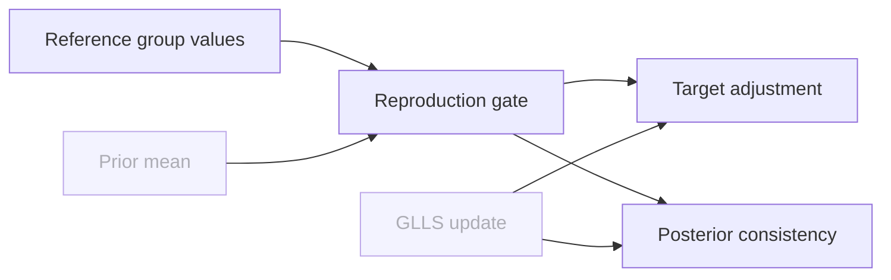

Both libraries are processed the same way into the 979-state layout, giving
$x^{(0)}$ (ENDF/B-VIII.0) and $x^{(1)}$ (ENDF/B-VIII.1). A QID is compared
only if $x^{(0)}$ reproduces the prior mean $\mu_i$ on it. Per compared state
$j$:

$$
t_j = \frac{x^{(1)}_j - \mu_{i,j}}{\mu_{i,j}},
\qquad
r_j = \frac{\mu_{f,j} - \mu_{i,j}}{\mu_{i,j}},
\qquad
z_j = \frac{x^{(1)}_j - \mu_{f,j}}{\sigma_{f,j}},
\qquad
\text{toward: } \lvert \mu_{f,j} - x^{(1)}_j \rvert < \lvert \mu_{i,j} - x^{(1)}_j \rvert
$$

| Node | Meaning | Terms | Status |
|---|---|---|---|
| `ReferenceGroupValues` | Group values of a reference library on the 979-state layout, from NJOY with the release's processing input: GROUPR for cross sections and nu-bar, ERRORR for mubar and for PFNS spectra, PFNS slices averaged over the input's incident energies | reference group values, ENDF/B-VIII.1 | implemented |
| `ReproductionGate` | Compare a QID with VIII.1 only if the same processing of VIII.0 reproduces the released prior means on that QID; list the QIDs that fail, with their error | reproduction gate | implemented |
| `TargetAdjustment` | Relative change from the prior to VIII.1 per state, set against the relative mean adjustment; count the states the update moved toward VIII.1 | target adjustment, relative mean adjustment | implemented |
| `PosteriorConsistency` | VIII.1's distance from the posterior mean in posterior standard deviations per state; count states within one and two | consistency pull | implemented |
| `PriorMean` | See Prior | | external |
| `Glls` | See L1 | | external |

### L2 · Submission (`Submission`)

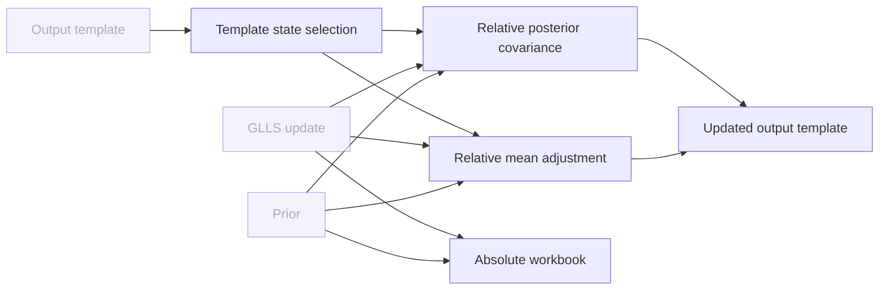

Absolute to relative, always against the prior mean (method rule):

$$
r_j = \frac{\mu_{f,j} - \mu_{i,j}}{\mu_{i,j}},
\qquad
(R_f)_{jk} = \frac{(\Sigma_f)_{jk}}{\mu_{i,j}\, \mu_{i,k}}
\quad\Longleftrightarrow\quad
R_f = D_{\mu_i}^{-1} \Sigma_f D_{\mu_i}^{-1}
$$

The same map applied to $\Sigma_i$ returns the released $R_i$, which the
template's prior sheet holds. Before 2026-10-22, $R_f$ was divided by the
posterior mean $\mu_{f,j}\,\mu_{f,k}$. Entries with $\mu_{i,j} = 0$ are
undefined and written as NaN; the released $R_i$ there is at most
$1.2 \times 10^{-19}$ in magnitude.

The template holds $928$ of the $979$ states in one axis order: seven
cross-section QIDs, ten mubar, MT452, then ten PFNS slices, without the 51
MT456 states. Both covariance sheets are full $928 \times 928$ matrices,
including the cross-section–PFNS blocks.

| Node | Meaning | Terms | Status |
|---|---|---|---|
| `TemplateSelection` | Map template rows and columns to states by their labels, never by fixed cell positions | template state selection, MT456 | implemented |
| `RelativeMeanAdjustment` | Posterior minus prior mean, divided by the prior mean | relative mean adjustment | implemented |
| `RelativePosteriorCovariance` | Posterior (and prior) covariance divided by the product of two prior means | normalized on prior, relative covariance | implemented |
| `AbsoluteWorkbook` | All 979 states with prior and posterior means, standard deviations and full absolute covariances | absolute workbook | implemented |
| `UpdatedTemplate` | The release 4 template filled (release 3 until 2026-11-23): questions sheet, prior sheets, relative mean adjustment, full posterior relative covariance, scientific format with 11 significant digits | output template, questions sheet, prior sheets, method rule | implemented |
| `Prior` | See L1 | | external |
| `Glls` | See L1 | | external |
| `OutputTemplate` | See Release data | | external |

### L2 · Validation (`Validation`)

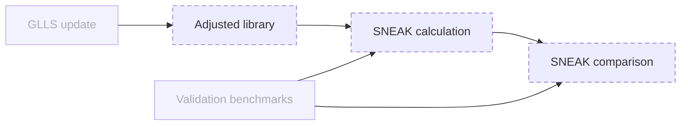

$$
\left(\frac{C}{E}\right)_{\text{prior}}
\quad\text{vs}\quad
\left(\frac{C}{E}\right)_{\text{posterior}}
\qquad\text{for SNEAK-7A/B } k_\text{eff} \text{ and spectral indices}
$$

**Open:** the SNEAK calculation can be a transport run with an adjusted
library, or a linear estimate $C + S_\text{SNEAK}(\mu_f - \mu_i)$, which needs
SNEAK sensitivities. The release provides models; the choice is undecided.

| Node | Meaning | Terms | Status |
|---|---|---|---|
| `AdjustedLibrary` | Pu-239 nuclear data carrying the posterior, in a form a transport code can read | adjusted library | planned |
| `SneakCalculation` | SNEAK-7A/B responses calculated with prior and adjusted data | SNEAK | planned |
| `SneakComparison` | C/E of the SNEAK responses before and after adjustment | C/E, SNEAK | planned |
| `Glls` | See L1 | | external |
| `ValidationSet` | See Release data | | external |
