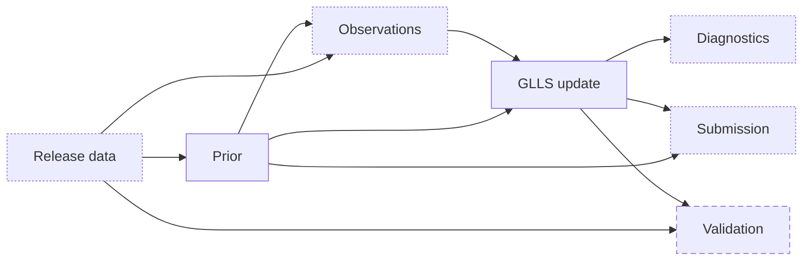
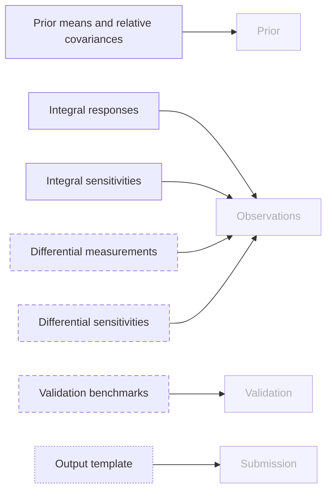
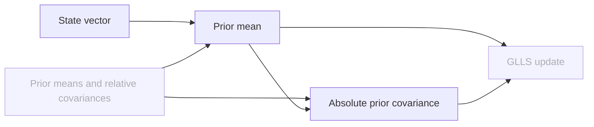
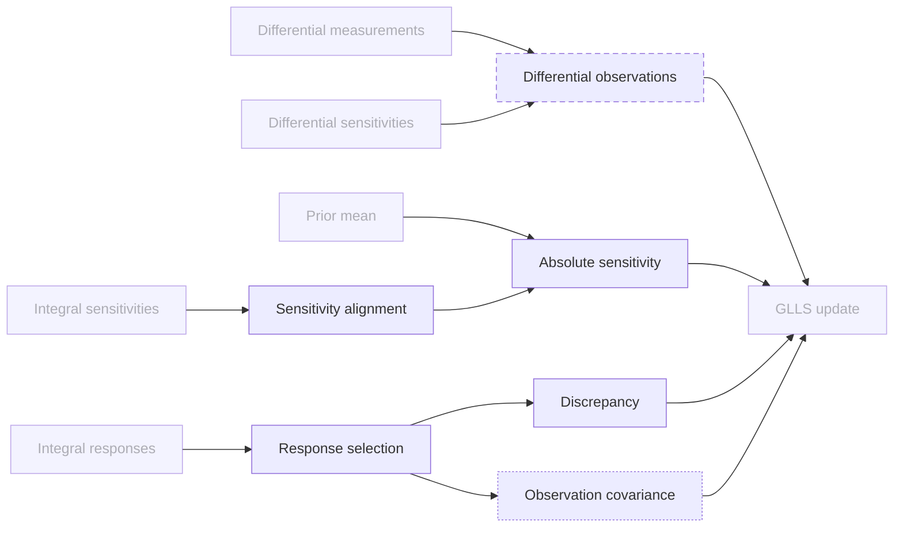
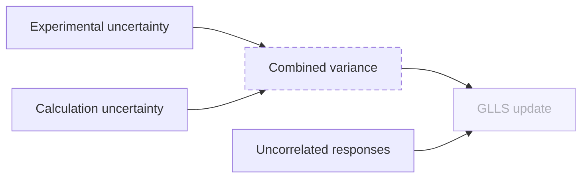
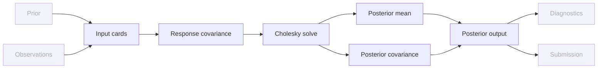
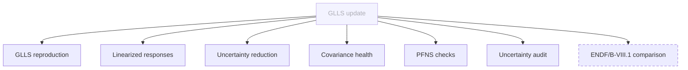
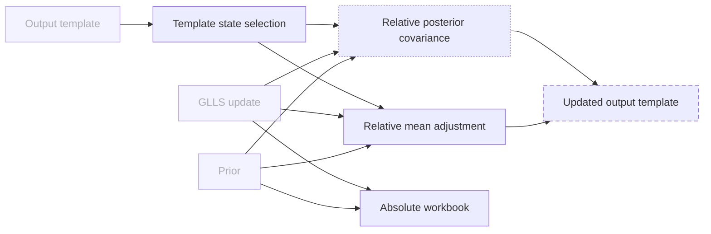
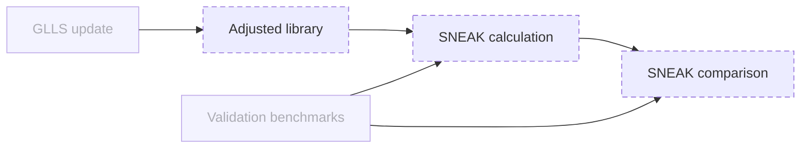

# Concepts

Reference set: [CODE](CODE.md) · [DEFINITIONS](DEFINITIONS.md) ·
[EXERCISES](EXERCISES.md) · [TESTS](TESTS.md)

How the SG52 Pu-239 adjustment works, as concepts. L1 is the whole method, each
L2 diagram opens one L1 node, and L3 diagrams spell out rules with steps. Status
per node: `implemented`, `partial`, `planned`, or `external` (a node owned by
another diagram, shown for context). Dashed boxes are planned, dotted boxes are
partial.

## Notation

All vectors are columns. $D_v = \operatorname{diag}(v)$ turns a vector into a
diagonal matrix, so $D_v^{-1}$ divides element-wise by $v$.

| Symbol | Meaning | Size |
|---|---|---|
| $x$ | state vector of Pu-239 nuclear data | $n = 979$ |
| $\mu_i$, $\Sigma_i$ | prior mean and absolute prior covariance | $n$, $n \times n$ |
| $R_i$ | released relative prior covariance | $n \times n$ |
| $\mu_f$, $\Sigma_f$ | posterior mean and absolute posterior covariance | $n$, $n \times n$ |
| $E$, $C$ | measured and calculated response values | $m$ |
| $\sigma_E$, $\sigma_C$ | experimental and calculation uncertainties | $m$ |
| $\Delta$ | discrepancy $E - C$ | $m$ |
| $s$, $S$ | relative and absolute sensitivities | $m \times n$ |
| $\Sigma_E$ | observation covariance | $m \times m$ |
| $V$ | response covariance | $m \times m$ |

The method in three lines: convert the relative release data to absolute form,
update in absolute form, convert the result back to relative form against the
prior.

$$
\Sigma_i = D_{\mu_i} R_i D_{\mu_i},
\qquad S = D_C\, s\, D_{\mu_i}^{-1}
\qquad \text{(relative} \to \text{absolute)}
$$

$$
\mu_f = \mu_i + \Sigma_i S^\top V^{-1} \Delta,
\qquad \Sigma_f = \Sigma_i - \Sigma_i S^\top V^{-1} S \Sigma_i,
\qquad V = S \Sigma_i S^\top + \Sigma_E
\qquad \text{(absolute GLLS)}
$$

$$
r = D_{\mu_i}^{-1} (\mu_f - \mu_i),
\qquad R_f = D_{\mu_i}^{-1} \Sigma_f D_{\mu_i}^{-1}
\qquad \text{(absolute} \to \text{relative, normalized on prior)}
$$

## L1 · SG52 adjustment

| Node | Meaning | Terms | Status |
|---|---|---|---|
| `ReleaseData` | The coordinators' input package: prior covariances, integral and differential data with sensitivities, validation benchmarks and the output template. Integral data and prior are used; differential and validation data are not yet | release, release data | partial |
| `Prior` | ENDF/B-VIII.0 Pu-239 means and absolute covariance on the state vector | prior, state vector | implemented |
| `Observations` | Discrepancies, absolute sensitivities and observation covariance for the responses an exercise uses. Integral responses are built; differential measurements are not; the observation covariance does not yet follow the method rule | observation, integral response, differential measurement | partial |
| `Glls` | Linear Bayesian update of the prior with the observations, in absolute form | GLLS, posterior | implemented |
| `Diagnostics` | Checks and summaries of the update: reproduction, linearized responses, uncertainty reduction, covariance health, PFNS normalization and positivity. Comparison with ENDF/B-VIII.1 is not built | linearized prediction, PFNS normalization | partial |
| `Submission` | Relative and absolute results filled into the output template. Uses the old template and normalizes the posterior relative covariance on the posterior mean, against the method rule | output template, submission | partial |
| `Validation` | Predict the validation benchmarks with the adjusted data and compare with measurement | validation benchmark | planned |

### L2 · Release data (`ReleaseData`)

| Node | Meaning | Terms | Status |
|---|---|---|---|
| `PriorCovariances` | Released ENDF/B-VIII.0 Pu-239 group means and relative covariance blocks, one file per QID pair | relative covariance, QID | implemented |
| `IntegralSet` | JEZEBEL and EUCLID responses: measured and calculated values with their uncertainties, in released row order | integral response, experimental uncertainty, calculation uncertainty | implemented |
| `IntegralSensitivities` | Relative sensitivities of each integral response to every released nuclide parameter | relative sensitivity | implemented |
| `DifferentialSet` | Marini nu-bar, Marini and Keegan PFNS, Snyder and Dongwi fission ratios, SACS-Cf, with their covariances | differential measurement, EXFOR | planned |
| `DifferentialSensitivities` | Sensitivities of each differential measurement to the state vector | relative sensitivity | planned |
| `ValidationSet` | SNEAK-7A/B models and measured responses | validation benchmark, SNEAK | planned |
| `OutputTemplate` | The NEA results workbook. The release 2 version is read; the release 3 version (prior and questions sheets, full covariance) is not | output template | partial |
| `Prior` | See L1 | | external |
| `Observations` | See L1 | | external |
| `Validation` | See L1 | | external |
| `Submission` | See L1 | | external |

### L2 · Prior (`Prior`)

The state vector stacks nine ordinary quantities on 51 energy groups, ten PFNS
slices (one per incident-energy group) on 51 outgoing groups, and ten mubar
values:

$$
n = \underbrace{9 \times 51}_{459} + \underbrace{10 \times 51}_{510} + \underbrace{10}_{\text{mubar}} = 979
$$

Relative to absolute, entry by entry and as a matrix:

$$
(\Sigma_i)_{jk} = \mu_{i,j}\, (R_i)_{jk}\, \mu_{i,k}
\qquad\Longleftrightarrow\qquad
\Sigma_i = D_{\mu_i} R_i D_{\mu_i}
$$

| Node | Meaning | Terms | Status |
|---|---|---|---|
| `StateVector` | Canonical ordering of the 979 states by QID and energy group; every other array is aligned to it | state vector, QID, energy group | implemented |
| `PriorMean` | Released group means flattened in state-vector order | prior, ENDF/B-VIII.0 | implemented |
| `AbsolutePriorCovariance` | Released relative blocks scaled by both prior means and assembled into one symmetric matrix | absolute covariance, relative covariance | implemented |
| `PriorCovariances` | See Release data | | external |
| `Glls` | See L1 | | external |

### L2 · Observations (`Observations`)

Discrepancy, and relative to absolute sensitivity. The released sensitivity is
relative to the calculated value, so the conversion multiplies by $C$ and
divides by the prior mean:

$$
\Delta_k = E_k - C_k,
\qquad
s_{kj} = \frac{\partial C_k / C_k}{\partial x_j / x_j},
\qquad
S_{kj} = \frac{\partial C_k}{\partial x_j} = \frac{C_k\, s_{kj}}{\mu_{i,j}}
\quad\Longleftrightarrow\quad
S = D_C\, s\, D_{\mu_i}^{-1}
$$

Columns for nuclides outside the state vector are dropped; states with no
released sensitivity get a zero column.

Relative form, if ever used, must normalize every term on the same vector
$N$, either $E$ or $C$ (method rule):

$$
\tilde\Delta = D_N^{-1} \Delta,
\qquad
\tilde\Sigma_E = D_N^{-1} \Sigma_E D_N^{-1},
\qquad
\tilde S = D_N^{-1} S D_{\mu_i} = D_N^{-1} D_C\, s
$$

With $N = C$ the released $s$ is used as is; with $N = E$ it must be scaled by
$C/E$. Using $s$ unscaled next to $E$-normalized discrepancies is the mixing
the rule forbids. The workflow stays absolute, so the rule holds by
construction.

| Node | Meaning | Terms | Status |
|---|---|---|---|
| `ResponseSelection` | Pick the responses an exercise uses, by response ID, keeping released order | integral response, response ID | implemented |
| `Discrepancy` | Measured minus calculated value per response | discrepancy | implemented |
| `SensitivityAlignment` | Map each released Pu-239 sensitivity column to its state; reject duplicates and unknown parameters | relative sensitivity, state vector | implemented |
| `AbsoluteSensitivity` | Convert relative sensitivities to absolute derivatives with the calculated value and the prior mean | absolute sensitivity | implemented |
| `ObservationCovariance` | Covariance of the discrepancies. Uses the published total uncertainty today; the method rule asks for the experimental and calculation components | observation covariance, assumption | partial |
| `DifferentialObservations` | Discrepancies, sensitivities and covariances of differential measurements on the same state vector | differential measurement | planned |
| `IntegralSet` | See Release data | | external |
| `IntegralSensitivities` | See Release data | | external |
| `DifferentialSet` | See Release data | | external |
| `DifferentialSensitivities` | See Release data | | external |
| `PriorMean` | See Prior | | external |
| `Glls` | See L1 | | external |

#### L3 · Observation covariance (`ObservationCovariance`)

$$
\Sigma_E = \operatorname{diag}\!\left(\sigma_{E,k}^2 + \sigma_{C,k}^2\right)
\qquad \text{(method rule; today } \operatorname{diag}(\sigma_{\text{tot},k}^2) \text{)}
$$

The release defines its bias with the same denominator,
$(C - E) / \sqrt{\sigma_E^2 + \sigma_C^2}$.

| Node | Meaning | Terms | Status |
|---|---|---|---|
| `ExperimentalUncertainty` | Released absolute uncertainty of each measured value; read and stored | experimental uncertainty | implemented |
| `CalculationUncertainty` | Released absolute uncertainty of each calculated value; read and stored | calculation uncertainty | implemented |
| `CombinedVariance` | Sum of the squared experimental and calculation uncertainties per response, replacing the published total | observation covariance, method rule | planned |
| `UncorrelatedResponses` | Off-diagonal entries are zero, because the release gives no covariance between responses | assumption | implemented |
| `Glls` | See L1 | | external |

### L2 · GLLS update (`Glls`)

Absolute GLLS. $V$ is symmetric positive definite, so it is factorized once
and both right-hand sides are solved without forming $V^{-1}$:

$$
V = S \Sigma_i S^\top + \Sigma_E = L L^\top,
\qquad V a = \Delta,
\qquad V B = S \Sigma_i
$$

$$
\mu_f = \mu_i + \Sigma_i S^\top a,
\qquad
\Sigma_f = \Sigma_i - \Sigma_i S^\top B
$$

| Node | Meaning | Terms | Status |
|---|---|---|---|
| `InputCards` | Read prior, observations and output targets named by input cards; check shapes | input card | implemented |
| `ResponseCovariance` | Prior response covariance plus observation covariance | response covariance | implemented |
| `CholeskySolve` | Factorize the response covariance and solve for the gain terms; fail if it is not positive definite | response covariance | implemented |
| `PosteriorMean` | Prior mean plus the gain applied to the discrepancy | posterior | implemented |
| `PosteriorCovariance` | Prior covariance minus the information gained | posterior, absolute covariance | implemented |
| `PosteriorOutput` | Write posterior mean and covariance as float64 datasets | posterior | implemented |
| `Prior` | See L1 | | external |
| `Observations` | See L1 | | external |
| `Diagnostics` | See L1 | | external |
| `Submission` | See L1 | | external |

### L2 · Diagnostics (`Diagnostics`)

Linearized responses and the residual identity that ties them to the update:

$$
C_f = C + S (\mu_f - \mu_i),
\qquad
E - C_f = \Sigma_E V^{-1} \Delta
$$

Response uncertainty before and after, from the same sensitivities:

$$
\sigma_{C,i} = \sqrt{\operatorname{diag}(S \Sigma_i S^\top)},
\qquad
\sigma_{C,f} = \sqrt{\operatorname{diag}(S \Sigma_f S^\top)}
$$

PFNS normalization per incident-energy slice $p$, flagged above $10^{-6}$, and
positivity per state:

$$
\varepsilon_p = \left\lvert \sum_{g=1}^{51} \mu_{f,(p,g)} - 1 \right\rvert,
\qquad
\mu_{f,j} \ge 0
$$

| Node | Meaning | Terms | Status |
|---|---|---|---|
| `GllsReproduction` | Recompute the update independently and compare with the program's posterior | GLLS | implemented |
| `LinearizedResponses` | Posterior responses predicted to first order, C/E before and after, and the residual identity | linearized prediction, residual identity, C/E | implemented |
| `UncertaintyReduction` | Prior and posterior standard deviations per state, family and QID, and each response's variance split by QID | uncertainty reduction | implemented |
| `CovarianceHealth` | Symmetry error and eigenvalue range of the prior and posterior covariances | absolute covariance | implemented |
| `PfnsChecks` | Normalization of each posterior PFNS slice and sign of every posterior state; flags only, no correction | PFNS normalization, positivity | implemented |
| `UncertaintyAudit` | Compare the published total uncertainty with the quadrature of its components | `total_uncert`, experimental uncertainty | implemented |
| `EndfComparison` | Compare the posterior with ENDF/B-VIII.1 on the same state vector | ENDF/B-VIII.1 | planned |
| `Glls` | See L1 | | external |

### L2 · Submission (`Submission`)

Absolute to relative, always against the prior mean (method rule):

$$
r_j = \frac{\mu_{f,j} - \mu_{i,j}}{\mu_{i,j}},
\qquad
(R_f)_{jk} = \frac{(\Sigma_f)_{jk}}{\mu_{i,j}\, \mu_{i,k}}
\quad\Longleftrightarrow\quad
R_f = D_{\mu_i}^{-1} \Sigma_f D_{\mu_i}^{-1}
$$

Today $R_f$ is divided by $\mu_{f,j}\,\mu_{f,k}$ instead. The same map applied to
$\Sigma_i$ returns the released $R_i$, which is the prior the updated template
asks for. Entries with $\mu_{i,j} = 0$ are undefined and written as NaN.

The template holds $928$ of the $979$ states: $418$ cross-section and mubar
states plus $510$ PFNS states, without the 51 MT456 states.

| Node | Meaning | Terms | Status |
|---|---|---|---|
| `TemplateSelection` | Map template rows and columns to states by their labels, never by fixed cell positions | template state selection, MT456 | implemented |
| `RelativeMeanAdjustment` | Posterior minus prior mean, divided by the prior mean | relative mean adjustment | implemented |
| `RelativePosteriorCovariance` | Posterior covariance divided by the product of two means; must use the prior means | normalized on prior, relative covariance | partial |
| `AbsoluteWorkbook` | All 979 states with prior and posterior means, standard deviations and full absolute covariances | absolute workbook | implemented |
| `UpdatedTemplate` | The release 3 template: prior and questions sheets, full covariance, scientific format with 11 significant digits | output template, method rule | planned |
| `Prior` | See L1 | | external |
| `Glls` | See L1 | | external |
| `OutputTemplate` | See Release data | | external |

### L2 · Validation (`Validation`)

$$
\left(\frac{C}{E}\right)_{\text{prior}}
\quad\text{vs}\quad
\left(\frac{C}{E}\right)_{\text{posterior}}
\qquad\text{for SNEAK-7A/B } k_\text{eff} \text{ and spectral indices}
$$

**Open:** the SNEAK calculation can be a transport run with an adjusted
library, or a linear estimate $C + S_\text{SNEAK}(\mu_f - \mu_i)$, which needs
SNEAK sensitivities. The release provides models; the choice is undecided.

| Node | Meaning | Terms | Status |
|---|---|---|---|
| `AdjustedLibrary` | Pu-239 nuclear data carrying the posterior, in a form a transport code can read | adjusted library | planned |
| `SneakCalculation` | SNEAK-7A/B responses calculated with prior and adjusted data | SNEAK | planned |
| `SneakComparison` | C/E of the SNEAK responses before and after adjustment | C/E, SNEAK | planned |
| `Glls` | See L1 | | external |
| `ValidationSet` | See Release data | | external |
